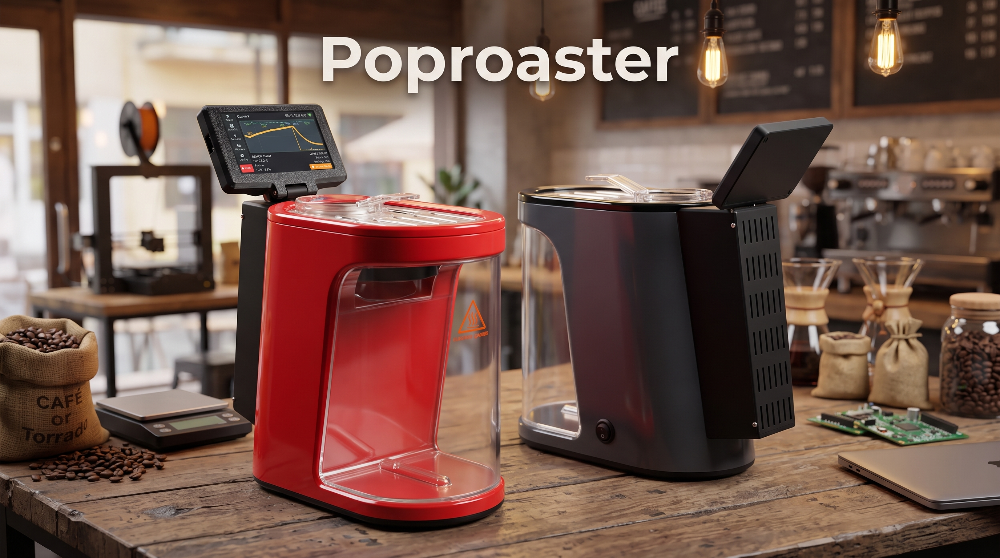
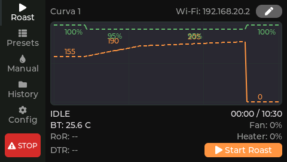
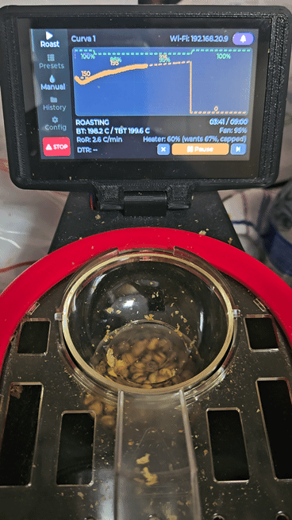

# Pop Roaster

Um torrador de café caseiro feito em cima de uma pipoqueira elétrica de ar
quente, controlado por um ESP32-S3. Barato e *overengineered* de propósito,
torra até **80 gramas** de café por vez.

Tem um **display touch** próprio para acompanhar a torra ao vivo, editar
perfis e ver o histórico. Com os **presets** (tempo, temperatura e fan por
segmento), a torra pode ser **100% automática**: escolha o preset, carregue o
café e o firmware conduz até o resfriamento.



### Pontos fortes

- **Barato:** base de pipoqueira comum e poucos módulos prontos (veja a BOM).
- **Repetível:** PID em malha fechada seguindo o perfil, com rampa entre os
  segmentos.
- **Flexível:** modo Manual ou controle pelo Artisan via Modbus TCP.
- **Conectado:** dashboard no navegador, histórico com CSV e firmware por OTA.
- **Seguro:** corte por temperatura, detecção de falha de sensor/fan e
  Emergency Stop sempre visível.



## BOM (lista de componentes)


| Item | Part Number | Link | Comentário |
|---|---|---|---|
| Pipoqueira | | [link](https://shopee.com.br/Pipoqueira-El%C3%A9trica-Super-Premium-1200W-Sem-%C3%93leo-Ar-Quente-i.389800143.22498754445) | |
| Display | JC4827W543 | [link](https://pt.aliexpress.com/item/1005006729377800.html) | Selecionar Capacitive Touch |
| SSR | SSR-40DA | [link](https://pt.aliexpress.com/item/1005005943909513.html) | Aquecedor |
| Módulo MOSFET (PWM do fan) | XY-MOS | [link](https://pt.aliexpress.com/item/1005012364216704.html) | |
| Termopar | MAX6675 | [link](https://pt.aliexpress.com/item/1005003841451196.html) | Selecionar Kit with probe |
| Fonte | 24V 2A | [link](https://br.shp.ee/zNRZV278) | Alimenta o Mini560 e o XY-MOS |
| Step-down | Mini560 (saída 5V) | [link](https://pt.aliexpress.com/item/1005008280160694.html) | Alimenta o display (conector P1) a partir dos 24V |
| Capacitor cerâmico | 100nF | | Soldado nos pads do termopar do MAX6675, para estabilizar a leitura |
| Manta térmica de escapamento de moto (fibra de vidro) | | | Isola o aquecedor da carcaça de metal; o kit já vem com as braçadeiras (usei 2) |
| Fita de alumínio fina | | | Cobre a manta, para bloquear a radiação IR |
| Conectores/cabos JST1.25 de 4 pinos | | [link](https://pt.aliexpress.com/item/1005007277110532.html) | Selecionar o de 4 pinos. 3 unidades (P1, P2 e P4) |

## Montagem

A pinagem, o diagrama de ligações e as observações da montagem estão em
[`firmware/README.md`](firmware/README.md#hardware-wiring) (diagrama em
[`firmware/docs/wiring-diagram.svg`](firmware/docs/wiring-diagram.svg)). Os
arquivos 3D (suportes, caixa do display e STEP dos módulos) estão na pasta
[`3D/my-b022`](3D/my-b022).

> **Atenção - termostato original:** o termostato que vem na pipoqueira desarma
> em 180 °C e precisa ser **removido por completo**, senão ele corta o
> aquecedor no meio da torra e o processo falha. Sem ele, a proteção contra
> superaquecimento passa a ser só a do firmware (corte em 240 °C).
>
> **Atenção - rede elétrica:** o SSR e a fonte trabalham com tensão da rede.
> Use fiação e conectores adequados à corrente do aquecedor, isole tudo e
> aterre a carcaça. As proteções do firmware **não** substituem uma instalação
> elétrica correta.

## O que ele faz

**Durante a torra**

- Dashboard ao vivo com BT (temperatura do grão), RoR (taxa de subida), gráfico
  BT x curva alvo e tempo, na tela e no navegador (atualização em ~2 Hz).
- Fluxo completo: pré-aquecimento até o primeiro segmento, confirmação do
  Charge, torra, resfriamento e finalização automática, com o fan desligando
  sozinho quando a temperatura é segura.
- Marcação de eventos: Turning Point e Cool Start automáticos; Primeiro e
  Segundo Crack (início/fim) marcados por você com um toque.
- Pause/retomada, botão "Próximo segmento" para pular adiante na curva e
  cancelamento em dois estágios (primeiro resfria, depois encerra).
- Se a energia cair no meio da torra, a sessão é retomada na volta (o
  aquecedor só religa por comando seu).

**Perfis e controle**

- Perfis por segmento (tempo + temperatura + fan) com rampa entre os
  segmentos, editáveis na tela ou no navegador, e importáveis/exportáveis.
- Cada torra guarda uma cópia do perfil usado, então editar um preset depois
  não altera o histórico.
- Manual: você define a temperatura alvo e o nível do fan (90 / 95 / 100%) e o
  PID cuida do aquecedor. Se mexer no fan ou no aquecedor durante um perfil, o
  controle automático dá a vez a você até o próximo segmento.
- PID com ajuste ao vivo pela página de diagnóstico (ganhos, filtro da
  derivada, rampa de setpoint, curva de compensação do aquecedor, potência
  mínima durante a torra) e **autotune** na própria tela, com os ganhos salvos
  no equipamento.
- Limite de potência do aquecedor (Max Heater Power) para domar uma resistência
  forte demais e calibração do sensor por temperatura de referência.

**Histórico e análise**

- Histórico salvo no equipamento, com gráfico de BT x tempo, eventos e
  exportação em CSV.
- Log do PID (erro, termos P/I/D, potência aplicada) para baixar e analisar
  offline, útil para ajustar o controle com dados reais.

**Conectividade**

- Dashboard pelo navegador em `poproaster.local`, com presets, histórico,
  diagnóstico e Wi-Fi.
- Artisan via Modbus TCP, lendo BT/fan/aquecedor/RoR e podendo comandar fan e
  aquecedor ([passo a passo](firmware/docs/artisan-integration.md)).
- Atualização de firmware por OTA com rollback automático se a nova versão não
  subir, e instalação sem ferramentas pelo flasher web.
- Captura da tela do display pelo navegador (página Screen Capture), útil para
  documentação.
- Interface em inglês, português e espanhol (Config > Language).

**Diagnóstico e segurança**

- Tela de teste dos periféricos (sensor, fan e aquecedor) para validar a
  montagem antes da primeira torra.
- Aviso em 230 °C e corte automático em 240 °C, watchdog de duração da torra,
  detecção de falha de sensor e de ventoinha, aquecedor só liga com o fan
  rodando e Emergency Stop sempre visível.
## Gravar o firmware

Os binários ficam em [Releases](https://github.com/marceloajunqueira/poproaster/releases):

- `pop_roaster-full.bin`: imagem completa, para gravar no offset `0x0` (primeira instalação).
- `pop_roaster-ota.bin`: só o app, para atualização por OTA.

Os binários de cada build também ficam como artifact na execução do workflow.

Sem instalar nada: abra a página do flasher em
<https://marceloajunqueira.github.io/poproaster/> (Chrome ou Edge), conecte o
display por USB e clique em **Instalar firmware**. A página é publicada
automaticamente pelo workflow [`firmware.yml`](.github/workflows/firmware.yml)
a cada alteração em `firmware/` ou `flasher/` na branch `main`.

### Atualização por OTA

Com o equipamento na sua rede Wi-Fi, abra `http://poproaster.local/ota` (ou o
IP do equipamento) e envie o arquivo `pop_roaster-ota.bin`.

## Primeiro uso (Wi-Fi)

Sem rede configurada, o equipamento cria a rede aberta **PopRoaster-Setup**.
Conecte nela e informe o SSID e a senha da sua rede. Depois disso, o dashboard
fica em `http://poproaster.local/` (ou no IP atribuído pelo roteador). A rede
também pode ser trocada depois pela página `/wifi`.

O dashboard, o Modbus TCP do Artisan e a atualização por OTA **não têm
autenticação**: use apenas em rede local confiável e não exponha o
equipamento à internet.

## Compilar o firmware

Requer ESP-IDF v6.0 e o target `esp32s3`:

```powershell
cd firmware
idf.py set-target esp32s3
idf.py build
idf.py -p <PORTA> flash monitor
```

Mais detalhes técnicos (build, pinagem, segurança, etc.) estão em
[`firmware/README.md`](firmware/README.md).
