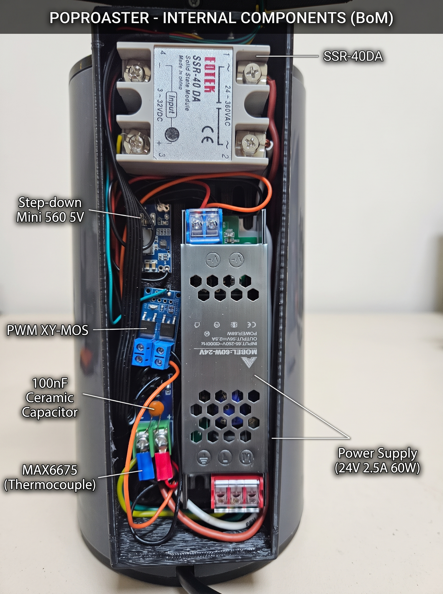
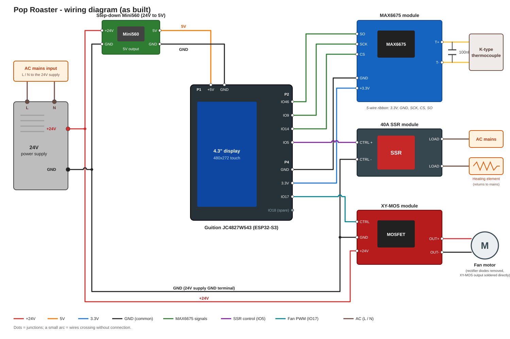
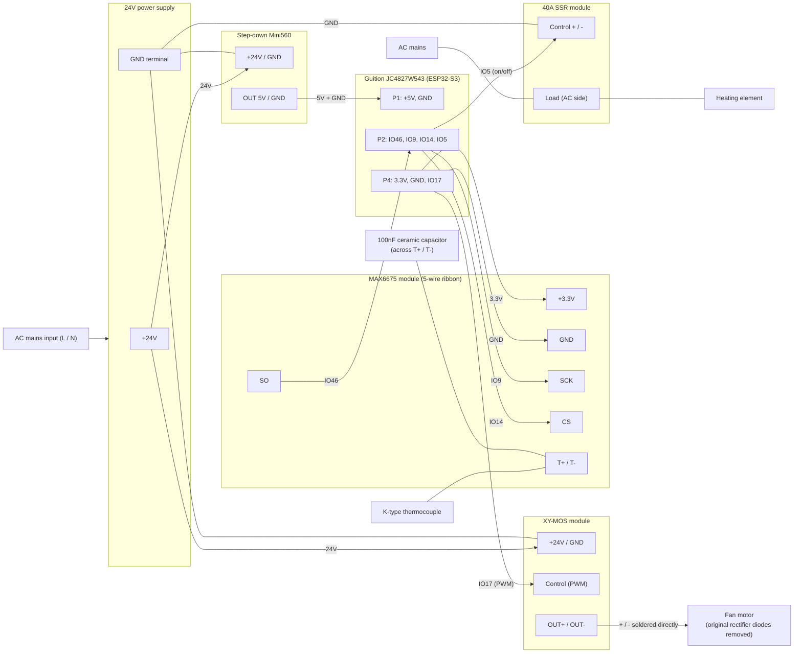

# Pop Roaster Firmware

ESP-IDF firmware for the Pop Roaster coffee roaster controller, running on a
Guition JC4827W543 board (ESP32-S3-WROOM-1-N4R8, 480x272 NV3041A display,
GT911 capacitive touch). Provides an on-device touchscreen UI, a WiFi web
dashboard, Artisan roasting-software integration (Modbus TCP), roast
profile/preset management, session history, and OTA updates.

Full requirements/design docs live in
[`specs/001-pop-roaster-control/`](../specs/001-pop-roaster-control/)
(`spec.md`, `plan.md`, `tasks.md`, `quickstart.md`).

## Requirements

- ESP-IDF v6.0 (this project has not been tested against other major
  versions; several fixes in this codebase specifically address v6.0 API
  changes — see `/memories/repo/firmware-build-notes.md` if you have access
  to it, otherwise check git history of this file).
- Target chip: `esp32s3`.
- A Guition JC4827W543 board (or a board with the same NV3041A/GT911/pin
  layout — see `components/board_config/boards/board_jc4827w543.h`).

## Building and flashing

```powershell
cd firmware
idf.py set-target esp32s3
idf.py build
idf.py -p <PORT> flash monitor
```

If you are using the VS Code ESP-IDF extension, open the `firmware/` folder
directly as the workspace root (not the repo root) — the extension expects
`CMakeLists.txt`/`sdkconfig` at the workspace root.

Flash size is 4MB (`CONFIG_ESPTOOLPY_FLASHSIZE_4MB`, already set in
`sdkconfig.defaults`). Partition layout is defined in
[`partitions.csv`](partitions.csv): dual OTA app slots (`ota_0`/`ota_1`,
1.5MB each) plus a LittleFS `storage` partition (~896KB) for roast session
history.

## Bill of materials (BOM)



| Item | Qty | Notes |
|------|-----|-------|
| Guition JC4827W543 board (ESP32-S3, 4.3" display) | 1 | Main controller |
| MAX6675 module + K-type thermocouple | 1 | Bean temperature sensor |
| Ceramic capacitor 100nF | 1 | Soldered across the thermocouple input pads of the MAX6675 module, to stabilize the reading |
| 40A SSR module | 1 | Heating element control |
| Fan MOSFET module | 1 | Fan motor PWM control |
| Step-down Mini560 (5V output) | 1 | Fed by the 24V power supply; supplies 5V to the board's P1 connector (+5V/GND) |
| JST1.25 4-pin connectors/cables | 3 | P1, P2, P4 |
| Fiberglass motorcycle exhaust heat wrap kit | 1 | Insulates the heater mechanism from the metal housing; the kit's own 2 metal clamps secure the wrap |
| Thin aluminum tape | 1 | Covers the heat wrap to block IR heat radiation |

## Hardware wiring

### Display & touch (fixed, on-board — no wiring needed)

The NV3041A display (QSPI) and GT911 touch controller (I2C) are soldered
directly to the JC4827W543 board. Pin assignments are fixed in
[`components/board_config/boards/board_jc4827w543.h`](components/board_config/boards/board_jc4827w543.h)
and are not user-configurable.

### External peripherals (user-wired via JST1.25 expansion connectors)

The board exposes 4 JST1.25 4-pin expansion connectors, but **this build
only uses 3 physical connectors** (P1, P2, P4) — P3 is left entirely
unused. Confirmed physical pinout:

| Connector | Pin 1 | Pin 2 | Pin 3 | Pin 4 | Used in this build? |
|-----------|-------|-------|-------|-------|----------------------|
| P1 | GND | RXD | TXD | +5V | Power IN only (GND + +5V); RXD/TXD left unconnected |
| P2 | IO46 | IO9 | IO14 | IO5 | Yes — all 4 pins (MAX6675 x3 + SSR) |
| P3 | IO6 | IO7 | IO15 | IO16 | **Not used** (spare, only 3 connectors on hand) |
| P4 | GND | 3.3V | IO17 | IO18 | Yes — 3.3V/GND power OUT + fan MOSFET (IO18 spare) |

> **Note:** IO46 is **input-only** on the ESP32-S3 — it must never be
> assigned to an output signal (SSR, fan PWM/MOSFET). It is used by default
> for the MAX6675's read-only SO/MISO line.

Default GPIO assignments (configurable via `idf.py menuconfig` →
**Pop Roaster Board Configuration** → **External Peripheral GPIOs**, see
[`components/board_config/Kconfig`](components/board_config/Kconfig)):

| Signal | Default GPIO | Connector/pin | Notes |
|--------|--------------|----------------|-------|
| MAX6675 SCK (clock) | IO9 | P2, pin 2 | |
| MAX6675 CS (chip select) | IO14 | P2, pin 3 | |
| MAX6675 SO / MISO | IO46 | P2, pin 1 | Input-only pin, read-only signal — safe pairing |
| SSR heater control (on/off) | IO5 | P2, pin 4 | Drives a **40A SSR module** controlling the heating element; time-proportioning (duty cycle) is done in software over this single digital output |
| Fan MOSFET control (PWM) | IO17 | P4, pin 3 | Drives a fan motor **MOSFET module**; 20kHz default switching frequency (inaudible), LEDC timer 1 / channel 1 |

All 3 MAX6675 signals **plus** the SSR live on **P2** (fits exactly: 4
signals in a 4-pin connector). The fan MOSFET moved to **P4** alongside the
3.3V/GND power-out pins, which frees **P3 completely** — this build only
needs 3 physical JST1.25 connectors (P1 power-in, P2, P4) instead of 4.

Spare GPIOs not assigned by default (available for future peripherals, e.g.
fan RPM feedback): IO6, IO7, IO15, IO16 (all of unused P3), IO18 (P4).

> **Power note:** power the MAX6675 module from **3.3V** (available on P4,
> alongside GND), not 5V — its SO/MISO output logic level scales with its
> supply voltage, and the ESP32-S3's GPIOs are not 5V-tolerant. Running the
> sensor at 3.3V keeps the SO signal at a safe voltage for `IO46`.

> **Thermocouple note:** solder a **100nF ceramic capacitor** across the
> thermocouple input pads (T+ / T-) of the MAX6675 module to stabilize the
> reading.

#### Power and wiring notes (as built)

- **24V power supply:** feeds the Mini560 step-down (which generates the 5V
  for the board's P1) and the XY-MOS module, which in turn drives the fan.
- **MAX6675:** powered with the **3.3V** that comes out of the display board.
  It is connected with a **5-wire ribbon cable**: 3.3V, GND and the GPIOs
  (SCK, CS, SO) come straight from the display board.
- **SSR:** powered from the **GND terminal of the 24V supply**, plus the
  control GPIO.
- **XY-MOS (fan):** already has GND on its input terminal, so only the
  **control GPIO** is soldered to it.
- **Fan motor:** in the original roaster the motor ran in series with the
  heating resistance, which dropped the voltage down to ~24V, and a
  4-diode bridge rectifier turned that into DC. The 4 diodes were **removed**
  and the **+ and - outputs of the XY-MOS were soldered directly to the
  motor**.

> **Original thermostat — must be removed:** the thermostat that ships with
> the original roaster trips at **180°C**. It must be **completely removed**,
> otherwise it will cut the heater mid-roast and the roasting process will
> fail.

#### Thermal insulation

After the whole assembly was finished, the entire heater mechanism was
wrapped in a **fiberglass motorcycle exhaust heat wrap**, to keep the heat
from spreading to the metal housing. The wrap was then covered with a thin
**aluminum tape**, to block IR heat radiation. These heat wrap kits come
with their own metal clamps; 2 of them were used to secure the wrap.

### Wiring summary

Complete wiring as built (all grounds are common):





| From | To | Signal |
|------|----|--------|
| AC mains L / N | 24V supply AC input | Mains input |
| 24V supply +24V | Mini560 +24V | Power |
| 24V supply GND | Mini560 GND | Ground |
| Mini560 OUT 5V / GND | Board P1 (+5V / GND) | Board power |
| 24V supply +24V | XY-MOS +24V | Fan power |
| 24V supply GND | XY-MOS GND (input terminal already has GND) | Ground |
| XY-MOS OUT+ / OUT- | Fan motor + / - (direct, diodes removed) | Fan drive |
| Board P4 3.3V | MAX6675 +3.3V | Sensor power |
| Board P4 GND | MAX6675 GND | Ground |
| Board P2 IO9 | MAX6675 SCK | Clock |
| Board P2 IO14 | MAX6675 CS | Chip select |
| MAX6675 SO | Board P2 IO46 | Data (input-only pin) |
| Board P2 IO5 | SSR control + | Heater on/off |
| 24V supply GND terminal | SSR control - | Ground |
| Board P4 IO17 | XY-MOS control | Fan PWM |
| 100nF capacitor | Across MAX6675 thermocouple pads (T+ / T-) | Noise filtering |

> **Safety:** the SSR and PWM modules switch mains-voltage/high-current
> loads (heating element, fan motor). Follow the module manufacturer's own
> isolation/wiring instructions, use appropriately rated wiring/connectors
> for the actual heater/fan current draw, and ensure proper enclosure and
> earthing. This firmware's software safety interlocks (below) are **not** a
> substitute for correct electrical installation.

## Software safety interlocks (summary)

See [`components/safety/safety_manager.c`](components/safety/safety_manager.c)
and `specs/001-pop-roaster-control/spec.md` for full details. Highlights:

- Fan speed is quantized to 5 discrete levels (Level 1-5 = 60/70/80/90/100%;
  Level 0 = off) - the motor doesn't behave predictably at arbitrary
  percentages; turning the fan on from a stop ramps smoothly over ~2s
  (soft start). The heater is only allowed on once the fan's REAL (live,
  interpolated) duty during that ramp has actually reached the floor, not
  just once the ramp was requested. Emergency Stop cuts the fan
  immediately, bypassing this.
- Heater requires fan ≥ Level 1 (60%) to be commanded on at all.
- Heater duty is additionally scaled by an operator-configurable "Max
  Heater Power" setting (Config tab, default 100%) - a linear proportional
  scale, not just a ceiling (e.g. at 50%, a requested 40% duty really only
  reaches 20%).
- Fan cannot be commanded to 0% while bean temperature ≥ 100°C (or the
  sensor reading is invalid — treated conservatively as "still hot").
- Sensor-failure detection forces the heater off.
- Duration watchdog auto-starts Cooling if a roast exceeds the configured
  maximum duration.
- Indirect fan-failure detection (anomalous rate-of-rise) forces the heater
  off and raises a critical alarm.
- Critical alarms require an explicit operator acknowledgement before any
  new heater command is accepted again.
- Emergency Stop (always visible on every screen/tab, and on the web
  dashboard) immediately cuts the heater and cancels the active session.

## Security considerations

This firmware is designed for a **trusted local network** (FR-021 in
`spec.md`): the web dashboard, Artisan Modbus TCP bridge, and OTA update
endpoint have **no authentication or transport encryption** (plain HTTP,
plain Modbus TCP). This is an explicit v1 design decision, not an oversight,
matching the project's "single-operator LAN appliance" scope. Concretely:

- **No login/auth on any web route** — anyone who can reach the device's IP
  on the local network can view telemetry, change fan/heater setpoints,
  start/cancel roasts, edit/delete presets, or trigger a firmware OTA
  upload. Do not expose this device's ports to the public internet (no port
  forwarding, no VPN-less remote access) — treat it like any other
  unauthenticated LAN appliance (e.g. a smart-home hub with no cloud
  account).
- **WiFi setup AP is open** (`WIFI_AUTH_OPEN`, in
  [`components/roaster_hal/wifi_provisioning.c`](components/roaster_hal/wifi_provisioning.c)) —
  it only exists transiently during initial provisioning; anyone in range
  could join it and submit different home-WiFi credentials during that
  window. Complete provisioning promptly after powering on a new device in
  an untrusted location.
- **Artisan Modbus TCP bridge** (`components/artisan_adapter/`) has no
  authentication either — any Modbus TCP client on the LAN can read
  telemetry registers, and (depending on mode) issue control writes. This
  mirrors how Artisan's own Modbus/serial integrations are normally used
  (a single roaster + a single laptop on the same bench network).
- **OTA firmware upload**
  ([`components/web_api/ota_routes.c`](components/web_api/ota_routes.c),
  [`components/roaster_hal/ota_manager.c`](components/roaster_hal/ota_manager.c)):
  any device on the LAN that can reach the web server can push a new
  firmware image. The uploaded image's integrity (magic bytes, header,
  checksum) is validated by `esp_ota_end()` **before** the boot pointer is
  switched to the new partition — a corrupt/incomplete/truncated upload is
  rejected and the device keeps running its current, known-good firmware.
  There is no cryptographic signature check on the image itself (ESP-IDF's
  Secure Boot / signed-app-image feature is not enabled in this project) —
  anyone who can reach the OTA endpoint can flash arbitrary firmware, not
  just an authentic Pop Roaster build. If you need to defend against a
  hostile actor on the same LAN (not just accidental misuse), evaluate
  enabling ESP-IDF Secure Boot + signed OTA images and/or putting the
  device on an isolated VLAN.
- **Recommended deployment**: keep the device on a home/workshop LAN behind
  a normal consumer router's NAT (no port forwarding), and treat the WiFi
  network itself (WPA2/WPA3 password) as the actual security boundary for
  this appliance — consistent with the constitution's stated trust model.

## Internationalization (i18n)

The on-device UI supports English (default), Portuguese, and Spanish via
compile-time string catalogs in
[`components/ui_display/i18n.c`](components/ui_display/i18n.c). Language
choice is switchable from **Config → Language** and persists across
reboots (NVS). Currently only the navigation sidebar and Config screen text
are localized end-to-end; a full per-screen retrofit of every remaining
label is not yet done (see `specs/001-pop-roaster-control/tasks.md` T055
notes).

## Artisan integration

See [`docs/artisan-integration.md`](docs/artisan-integration.md) for
step-by-step Artisan roasting-software setup instructions (Modbus TCP).
